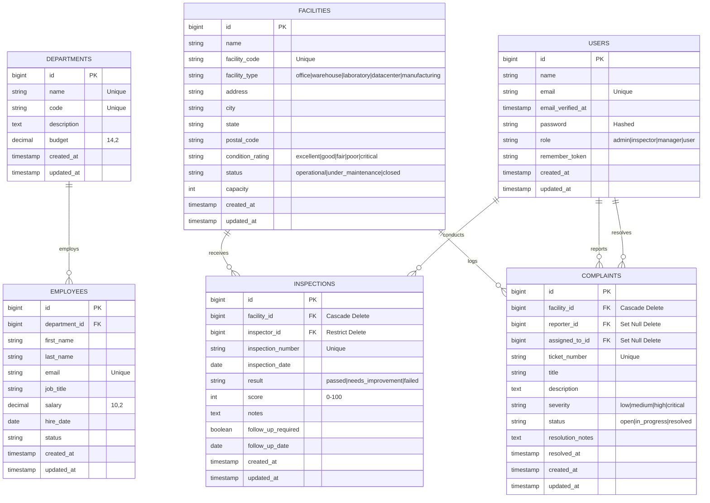

# FacilityOps Entity-Relationship (ER) Diagram

## 1. Relational Architecture
The relational model reflects a decoupled, scalable enterprise facility management data model. Facilities serve as the central operational hub, anchoring statutory compliance audits (`inspections`) and maintenance tickets (`complaints`). Departments organize operational budgets and staff (`employees`), while `users` represent authenticated operators and inspectors.

---

## 2. Referential Integrity & Cascade Rules

1. **`inspections` -> `facilities` (`facility_id`)**:
   - `ON UPDATE CASCADE`
   - `ON DELETE CASCADE`: If a facility is decommissioned and deleted, historical inspections are safely purged with the asset.
2. **`inspections` -> `users` (`inspector_id`)**:
   - `ON UPDATE CASCADE`
   - `ON DELETE RESTRICT`: An inspector profile cannot be accidentally dropped while certified compliance audit records depend on it.
3. **`complaints` -> `facilities` (`facility_id`)**:
   - `ON UPDATE CASCADE`
   - `ON DELETE CASCADE`: Asset tickets are cascade-removed if the parent facility is dropped.
4. **`complaints` -> `users` (`reporter_id` & `assigned_to_id`)**:
   - `ON UPDATE CASCADE`
   - `ON DELETE SET NULL`: Preserves historical work order maintenance documentation even if a contractor or personnel account is offboarded.
5. **`employees` -> `departments` (`department_id`)**:
   - `ON UPDATE CASCADE`
   - `ON DELETE RESTRICT`: Prevents orphaned employees when altering departmental structures.
