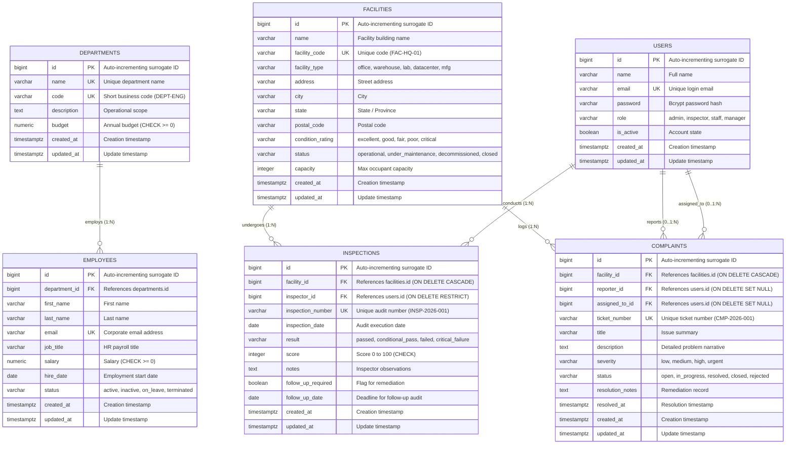

# Entity-Relationship (ER) Diagram & Architecture

**Domain:** Enterprise Facility & Employee Management System  
**Database Engine:** PostgreSQL 18.x (ANSI SQL:2016 Compliant)  
**Normalization:** Third Normal Form (3NF)

---

## 1. Visual Entity-Relationship Diagram

---

## 2. Relational Cardinality & Cascade Rules

| Relationship | Type | Foreign Key | Cascade / Delete Rule | Justification |
| :--- | :--- | :--- | :--- | :--- |
| `departments` → `employees` | 1-to-Many | `employees.department_id` | `ON DELETE RESTRICT` | Prevents accidental deletion of a department while employees are actively assigned to it. |
| `facilities` → `inspections` | 1-to-Many | `inspections.facility_id` | `ON DELETE CASCADE` | Inspections are child records of a physical facility. If a facility is purged, its audit logs delete with it. |
| `facilities` → `complaints` | 1-to-Many | `complaints.facility_id` | `ON DELETE CASCADE` | Maintenance tickets belong to a facility; purging the facility removes associated tickets. |
| `users` → `inspections` | 1-to-Many | `inspections.inspector_id` | `ON DELETE RESTRICT` | Regulatory audit compliance: cannot delete an inspector user account if signed inspection records exist. |
| `users` → `complaints` (reporter) | 0..1-to-Many | `complaints.reporter_id` | `ON DELETE SET NULL` | Tickets remain intact as historical records even if the reporter leaves or deletes their account. Supports anonymous submissions (`NULL`). |
| `users` → `complaints` (assignee) | 0..1-to-Many | `complaints.assigned_to_id` | `ON DELETE SET NULL` | If an assigned technician user account is deleted, the ticket becomes unassigned (`NULL`) rather than deleted. |

---

## 3. Normalization Verification (1NF to 3NF)

1. **First Normal Form (1NF):**
   - Every column contains atomic (indivisible) scalar values (no JSON arrays or comma-delimited strings used for relational links).
   - Every table possesses a clear surrogate primary key (`id BIGSERIAL`).
   - All rows in each relation are unique.

2. **Second Normal Form (2NF):**
   - Satisfies 1NF.
   - All non-key attributes are fully functionally dependent on the entire primary key (no partial key dependencies since all primary keys are single-column surrogate keys).

3. **Third Normal Form (3NF):**
   - Satisfies 2NF.
   - No transitive functional dependencies exist: non-key attributes depend only on the primary key, never on other non-key attributes (e.g., department budget and code live in `departments`, not duplicated in `employees`).
