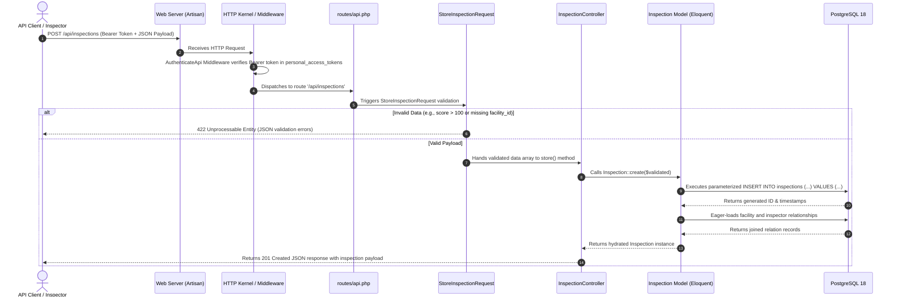

# Day 08: Laravel 11 CRUD REST API

**Domain:** Enterprise Facility & Employee Management System  
**Framework:** Laravel 11.57.0 (PHP 8.3+)  
**Database Driver:** PostgreSQL (`pgsql`) with PDO  
**Location:** `intern-week-1/day-08/laravel-api/`

---

## 🏗️ Architecture & Component Overview

This application implements an enterprise-grade RESTful API adhering strictly to Laravel conventions, Single Responsibility Principle (SRP), and clean separation of concerns:

```text
intern-week-1/day-08/laravel-api/
├── app/
│   ├── Http/
│   │   ├── Controllers/
│   │   │   ├── AuthController.php            # User registration, token issuance, logout, & profile
│   │   │   ├── FacilityController.php        # Facility CRUD, filtering, pagination, & relation loading
│   │   │   ├── InspectionController.php      # Compliance audit CRUD with score calculations
│   │   │   └── ComplaintController.php       # Maintenance incident tickets & lifecycle management
│   │   ├── Middleware/
│   │   │   └── AuthenticateApi.php           # Bearer token validation & request user attribution
│   │   └── Requests/                         # Form Requests encapsulating input validation rules
│   │       ├── StoreFacilityRequest.php
│   │       ├── UpdateFacilityRequest.php
│   │       ├── StoreInspectionRequest.php
│   │       ├── UpdateInspectionRequest.php
│   │       ├── StoreComplaintRequest.php
│   │       ├── UpdateComplaintRequest.php
│   │       ├── LoginRequest.php
│   │       └── RegisterRequest.php
│   └── Models/                               # Eloquent ORM entities with relationship definitions
│       ├── User.php                          # System security principals (inspections & complaints)
│       ├── Department.php                    # Cost centers (hasMany Employees)
│       ├── Employee.php                      # Workforce payroll records (belongsTo Department)
│       ├── Facility.php                      # Physical buildings (hasMany Inspections & Complaints)
│       ├── Inspection.php                    # Safety audits (belongsTo Facility & Inspector User)
│       └── Complaint.php                     # Incident tickets (belongsTo Facility, Reporter, Assignee)
├── database/
│   ├── migrations/                           # PostgreSQL DDL migrations matching relational schema
│   └── seeders/                              # Realistic seed datasets for all 6 tables
├── routes/
│   └── api.php                               # 20 versioned REST API routes (public vs protected)
├── tests/
│   └── Feature/                              # 27 automated feature tests covering all CRUD & Auth
├── .env.example                              # Template environment configuration for PostgreSQL
└── phpunit.xml                               # Automated testing configuration with in-memory SQLite
```

---

## 🔄 Request-to-Response Flow Lifecycle

Here is the exact journey of an incoming HTTP request through Laravel's architectural layers, illustrated using `POST /api/inspections` (recording a facility safety audit):



### Detailed Lifecycle Phases

1. **Client Request & Entry:**
   - The client sends an HTTP request: `POST /api/inspections` with `Authorization: Bearer <token>` and JSON body:
     ```json
     {
       "facility_id": 1,
       "inspector_id": 2,
       "inspection_number": "INSP-2026-099",
       "inspection_date": "2026-04-18",
       "result": "passed",
       "score": 95,
       "notes": "Optimal electrical safety verified."
     }
     ```
2. **Routing & Middleware Pipeline (`routes/api.php`):**
   - The request matches `Route::post('/api/inspections', [InspectionController::class, 'store'])`.
   - The route is guarded by `AuthenticateApi::class`.
   - The middleware inspects the `Authorization` header, computes `hash('sha256', $plainToken)`, and queries `personal_access_tokens`.
   - If missing or invalid, the pipeline aborts immediately with HTTP `401 Unauthorized`.
   - Upon success, the authenticated `User` model is injected into `$request->user()`.
3. **Form Request Validation (`StoreInspectionRequest`):**
   - Before the controller method executes, Laravel instantiates `StoreInspectionRequest`.
   - The rules run:
     - `facility_id`: Must exist in `facilities(id)`.
     - `score`: Must be integer between `0` and `100`.
     - `inspection_number`: Must be unique across `inspections`.
   - If validation fails, Laravel catches the `ValidationException` and immediately formats a standard JSON 422 error response.
4. **Controller Action (`InspectionController::store`):**
   - Receives clean, strongly typed data via `$request->validated()`.
   - Calls `Inspection::create($validated)`.
5. **Eloquent ORM & PostgreSQL Execution:**
   - Eloquent maps properties to database columns, generating a safe, parameterized SQL statement:
     ```sql
     INSERT INTO "inspections" ("facility_id", "inspector_id", "inspection_number", "inspection_date", "result", "score", "notes", "updated_at", "created_at") 
     VALUES ($1, $2, $3, $4, $5, $6, $7, $8, $9) RETURNING "id";
     ```
   - Relationships (`facility` and `inspector`) are loaded using eager loading (`with(...)`) to avoid $N+1$ query overhead.
6. **JSON Serialization & Response:**
   - The controller wraps the model in a standardized response envelope:
     ```json
     {
       "status": "success",
       "message": "Inspection logged successfully",
       "data": { ... }
     }
     ```
   - Laravel automatically sets `Content-Type: application/json` and returns HTTP `201 Created`.

---

## 🔐 Authentication System

The API employs a secure, stateless **Bearer Token Authentication** pattern backed by a `personal_access_tokens` table (Sanctum design):

1. **Registration:** `POST /api/auth/register` creates an account, hashes the password via bcrypt (`rounds=12`), and returns a 40-character plaintext bearer token.
2. **Login:** `POST /api/auth/login` verifies credentials via `Hash::check()` and issues a new bearer token.
3. **Token Hashing:** In accordance with OWASP security best practices, raw tokens are NEVER stored in the database. Only SHA-256 hashes are persisted (`hash('sha256', $token)`).
4. **Protected Mutations:**
   - Public: Read-only directory access (`GET /api/facilities`, `GET /api/inspections`, `GET /api/complaints`).
   - Protected: All data modifications (`POST`, `PUT`, `PATCH`, `DELETE`) require `Authorization: Bearer <token>`.
5. **Logout:** `POST /api/auth/logout` revokes and deletes the token hash from the database.

---

## 📡 Complete REST API Endpoint Catalog

### Authentication Endpoints

| Method | Endpoint | Access | Description |
| :--- | :--- | :--- | :--- |
| `POST` | `/api/auth/register` | Public | Register new user account; returns Bearer token |
| `POST` | `/api/auth/login` | Public | Authenticate email/password; returns Bearer token |
| `GET` | `/api/auth/me` | Protected | Fetch authenticated user profile |
| `POST` | `/api/auth/logout` | Protected | Invalidate current Bearer token |

### Facilities Endpoints

| Method | Endpoint | Access | Description |
| :--- | :--- | :--- | :--- |
| `GET` | `/api/facilities` | Public | List facilities (filters: `type`, `condition`, `status`, `city`, `search`, `per_page`) |
| `GET` | `/api/facilities/{id}` | Public | Show facility details with latest inspections & complaints |
| `POST` | `/api/facilities` | Protected | Create new facility |
| `PUT/PATCH` | `/api/facilities/{id}` | Protected | Update facility details |
| `DELETE` | `/api/facilities/{id}` | Protected | Delete facility (cascades inspections & complaints) |

### Inspections Endpoints

| Method | Endpoint | Access | Description |
| :--- | :--- | :--- | :--- |
| `GET` | `/api/inspections` | Public | List audits (filters: `facility_id`, `result`, `inspector_id`, `min_score`, `follow_up_required`) |
| `GET` | `/api/inspections/{id}` | Public | Show inspection record with facility and inspector profiles |
| `POST` | `/api/inspections` | Protected | Create new inspection report |
| `PUT/PATCH` | `/api/inspections/{id}` | Protected | Update inspection findings or remediation status |
| `DELETE` | `/api/inspections/{id}` | Protected | Delete inspection record |

### Complaints Endpoints

| Method | Endpoint | Access | Description |
| :--- | :--- | :--- | :--- |
| `GET` | `/api/complaints` | Public | List tickets (filters: `facility_id`, `status`, `severity`, `assigned_to_id`, `search`) |
| `GET` | `/api/complaints/{id}` | Public | Show complaint ticket with facility, reporter, and technician |
| `POST` | `/api/complaints` | Protected | File new maintenance ticket |
| `PUT/PATCH` | `/api/complaints/{id}` | Protected | Update ticket status/notes (auto-stamps `resolved_at` when resolved) |
| `DELETE` | `/api/complaints/{id}` | Protected | Delete complaint ticket |

---

## 🧪 Automated Testing Suite

The application includes a comprehensive test suite of **27 automated tests with 105 assertions** covering:
- **Happy Path CRUD:** Valid record creation, reads, updates, and deletes for all resources.
- **Form Request Validation (422):** Missing required fields, illegal values (e.g. `score = 150`), invalid enum strings, duplicate email/code checks.
- **Relational Integrity:** Foreign key existence validation (rejects invalid `facility_id` or `inspector_id`).
- **Resource Not Found (404):** Handled gracefully with JSON error messages.
- **Authentication & Security (401):** Rejection of unauthenticated mutation requests, token revocation on logout.

### Running the Tests

```powershell
# Navigate to the Laravel API directory
cd intern-week-1/day-08/laravel-api

# Execute the test suite using PHP artisan
& "C:\Users\LENOVO\tools\php\php.exe" artisan test
```

### Verified Test Output

```text
   PASS  Tests\Unit\ExampleTest
  ✓ that true is true

   PASS  Tests\Feature\AuthApiTest
  ✓ user can register with valid payload
  ✓ registration fails with duplicate email
  ✓ user can login with valid credentials
  ✓ login fails with invalid password
  ✓ protected route rejects unauthenticated request
  ✓ protected route allows authenticated user
  ✓ user can logout and revoke token

   PASS  Tests\Feature\FacilityApiTest
  ✓ can list facilities publicly
  ✓ can show single facility
  ✓ show returns 404 for nonexistent facility
  ✓ creating facility requires authentication
  ✓ authenticated user can create facility
  ✓ facility creation fails validation for missing fields or invalid condition
  ✓ can update facility
  ✓ can delete facility

   PASS  Tests\Feature\InspectionApiTest
  ✓ can list inspections
  ✓ can show inspection
  ✓ create inspection fails with nonexistent facility or illegal score
  ✓ can create valid inspection when authenticated
  ✓ can delete inspection

   PASS  Tests\Feature\ComplaintApiTest
  ✓ can list complaints publicly
  ✓ can show single complaint with relationships
  ✓ can create complaint ticket when authenticated
  ✓ updating status to resolved auto sets timestamp
  ✓ can delete complaint

   PASS  Tests\Feature\ExampleTest
  ✓ api health endpoint returns successful response

  Tests:    27 passed (105 assertions)
  Duration: 2.83s
```

---

## 🚀 Setup & Local Execution Guide

### 1. Environment Configuration (`.env`)

Copy the template `.env.example` to `.env`:

```powershell
cd intern-week-1/day-08/laravel-api
Copy-Item .env.example .env
```

Open `.env` and set your local PostgreSQL password:

```ini
DB_CONNECTION=pgsql
DB_HOST=127.0.0.1
DB_PORT=5432
DB_DATABASE=internship_day08
DB_USERNAME=postgres
DB_PASSWORD=your_actual_postgres_password
```

### 2. Generate Application Key

```powershell
& "C:\Users\LENOVO\tools\php\php.exe" artisan key:generate
```

### 3. Run Migrations and Seeders

Ensure the `internship_day08` database exists in PostgreSQL, then run:

```powershell
& "C:\Users\LENOVO\tools\php\php.exe" artisan migrate:fresh --seed
```

### 4. Start the Development Server

```powershell
& "C:\Users\LENOVO\tools\php\php.exe" artisan serve --port=8000
```

The API will be available at `http://localhost:8000/api/`. Test health via:

```bash
curl http://localhost:8000/api/health
```
